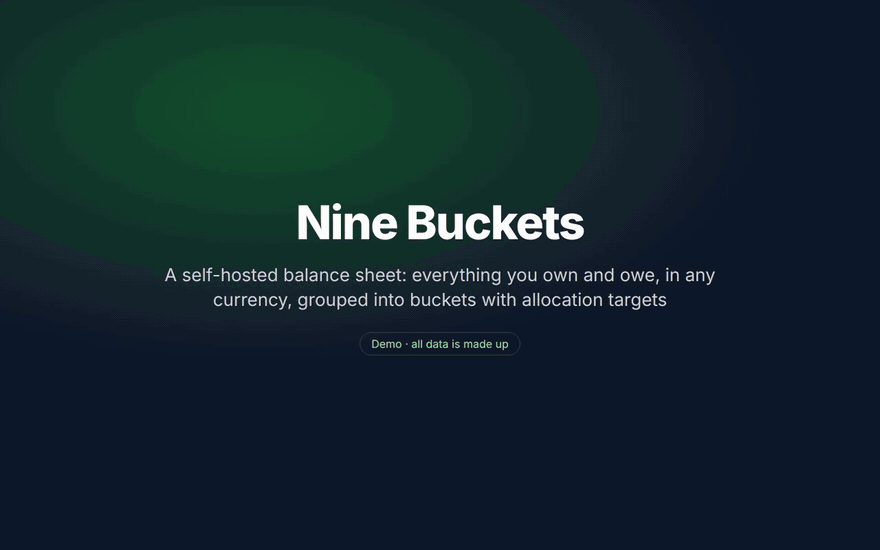

# Nine Buckets

**[User guide](docs/USER-GUIDE.md)** · **[Technical documentation](docs/DOCUMENTATION.md)** ·
[Install on a NAS](DEPLOY-NAS.md) · [Architecture](ARCHITECTURE.md) ·
[Demo video](docs/demo/networth-demo.mp4)

▶ **[Watch the full-quality demo video (MP4, about 2 minutes)](docs/demo/networth-demo.mp4)** · all data shown is made up

**Your whole financial picture on one page, on your own computer.**

Nine Buckets is a private net worth and asset-allocation tracker. You list what you own and what
you owe (bank accounts, investments, crypto, gold and silver, property, a business, collectibles,
loans) and it tells you what you're worth today, how that has changed over time, and whether your
money is spread the way you intended.

It replaces the spreadsheet you update every month, without handing your financial life to a
website.

## What you get

- **Your net worth at a glance.** Everything added up in US dollars, with a chart of how it's grown
  month by month.
- **Nine buckets with targets.** Every asset belongs to a bucket: Safety, Cash, Job Income,
  Business, Real Estate, Precious Metals, Crypto, Stocks or Collectibles. Set the share you want
  in each, and see at a glance which buckets are over or under, and roughly how much to buy or
  sell to fix it.
- **Prices that update themselves.** Stocks, ETFs, crypto and precious metals are valued at
  today's market price automatically. No more looking them up one at a time.
- **Any currency.** Keep euros, pounds, yen and more in their own currency; everything is
  converted for the totals.
- **What you paid, and what you've made.** Record your purchases and sales and the app works out
  your gains and losses, including dealer premiums on metals and network fees on crypto transfers.
- **Real estate done right.** A home counts as what you actually own of it: its value minus the
  mortgage, with how much of the loan you've paid off.
- **Quick monthly updates.** Click a balance, type the new number, press Enter. Every change can be
  undone.
- **Bring your history with you.** Import past trades from your own spreadsheet (checked before
  anything is saved, and undoable), and type in old year-end figures to fill in your chart.
- **Backups built in.** Automatic daily backups, one-click download, and a safe restore that keeps
  a copy of your current data first.

## Private by design

- **Runs on your own machine**, such as a home NAS or a spare computer, using Docker.
- **No bank logins, ever.** You enter balances yourself. The only things the app looks up online
  are market prices and exchange rates.
- **Protected by a passphrase**, and meant to be reached on your home network or over a private VPN
  like Tailscale, not from the open internet.

## What it isn't

Nine Buckets is a **balance sheet**, not a budget. It doesn't track day-to-day spending,
categorise transactions, or prepare taxes. Pair it with a budgeting app if you want those.

## Getting started

Someone comfortable with Docker sets it up once (about 10 minutes); after that it's all in the
browser.

1. **Install:** follow [Install and run](docs/DOCUMENTATION.md#2-install-and-run), or the
   step-by-step [NAS guide](DEPLOY-NAS.md).
2. **Set up:** the [User guide's first-time setup](docs/USER-GUIDE.md#first-time-setup) walks you
   through setting targets and adding your accounts.
3. **Each month:** follow the [monthly routine](docs/USER-GUIDE.md#your-monthly-routine), about
   10–15 minutes.

## Documentation

| Page | Who it's for | What's in it |
|---|---|---|
| [User guide](docs/USER-GUIDE.md) | Everyone | How to use the app in plain language: first-time setup, the monthly routine, how-tos, what the numbers mean, backups, common questions |
| [Technical documentation](docs/DOCUMENTATION.md) | Whoever runs the app | Installation, every setting, security, backups and restore, how values and gains are calculated, import format, troubleshooting, known limitations |
| [Install on a NAS](DEPLOY-NAS.md) | Whoever runs the app | Step by step NAS setup, data folders outside the repo, safe updates with `git pull`, NAS troubleshooting |
| [Architecture](ARCHITECTURE.md) | Developers | The code's structure and the design decisions that shouldn't be reversed |
| [Demo video](docs/demo/networth-demo.mp4) | Everyone | A 2-minute walkthrough of the main features, with made-up data |
| [How the demo video is made](scripts/demo/README.md) | Developers | The Docker-based recording pipeline, with fictional data |
| [`.env.example`](.env.example) · [`deploy.local.env.example`](deploy.local.env.example) | Whoever runs the app | Templates for your private settings |

## Inspiration

The allocation model is adapted from the "Ninja 9" bucket investing approach by
https://www.youtube.com/@EconomicNinja. This project isn't affiliated with or endorsed by him.
